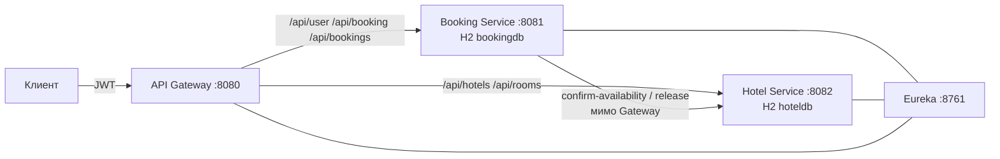
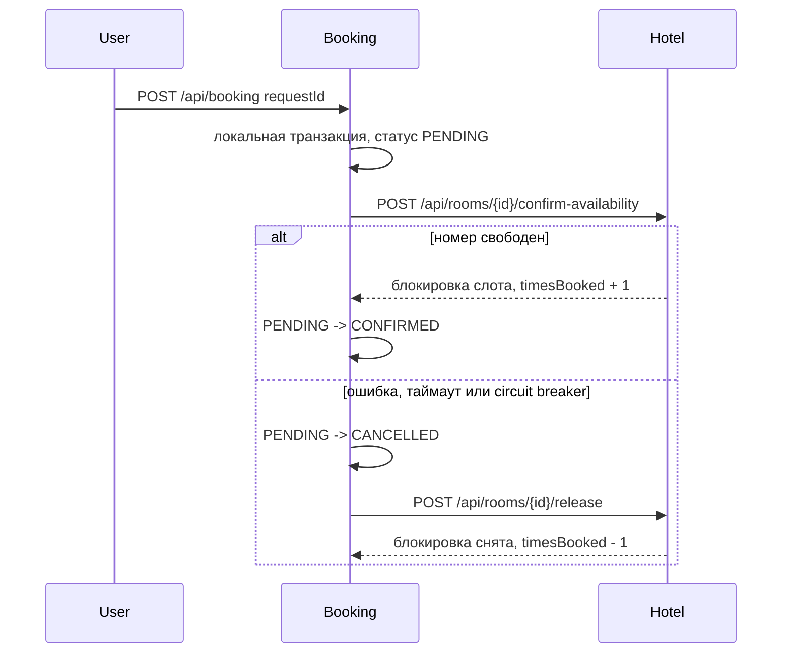

# Система бронирования отелей

Распределённое приложение на Spring Boot 3.5: регистрация сервисов, шлюз, отели и бронирования. У каждого бизнес-сервиса своя in-memory база H2. Глобальных транзакций нет: согласованность делается сагой с компенсацией.

## Как устроен репозиторий

Это Gradle multi-module. Каждый модуль, кроме `common`, — отдельное Spring Boot-приложение со своим `main`, портом и конфигом. `common` — маленькая библиотека (единый `ErrorDto`, ключ JWT, проверка дат), а не сервис.

| Модуль | Порт | База | Назначение |
| --- | --- | --- | --- |
| `eureka-server` | 8761 | нет | реестр сервисов |
| `api-gateway` | 8080 | нет | маршрутизация, проверка подписи JWT, correlation id |
| `hotel-service` | 8082 | H2 `hoteldb` | отели, номера, статистика, временная блокировка |
| `booking-service` | 8081 | H2 `bookingdb` | пользователи, JWT, бронирования, сага |

У Eureka и Gateway нет своей предметной базы: хранить им нечего. H2 есть там, где задание требует таблицы.

Пакет `enum` в Java назвать нельзя — это ключевое слово. Слой называется `enums`. Рядом с запрошенными слоями лежат `config`, `mapper` и, в booking, `client`: так контроллер остаётся тонким, а маппинг и удалённый вызов не смешиваются с доменной логикой. Реализации сервисов лежат в `service.impl` и зависят от интерфейсов.

```text
hotel-service / booking-service
  domain        JPA-сущности
  dto           запросы и ответы API
  repository    Spring Data
  enums         статусы и роли
  exception     исключения и единый разбор ошибок
  service       интерфейсы сценариев
  service.impl  бизнес-логика
  controller    REST
  mapper        MapStruct
  config        security, OpenAPI, фильтр корреляции, начальные данные
  client        только booking: вызов hotel-service
```

## Архитектура



Gateway не публикует `POST /api/rooms/{id}/confirm-availability` и `POST /api/rooms/{id}/release`. Эти вызовы идут из Booking Service напрямую по имени `hotel-service` из Eureka. Дополнительный фильтр шлюза отвечает 404, даже если маршрут когда-нибудь расширят слишком широко.

Каждый сервис сам проверяет JWT (resource server). Шлюз заранее отклоняет запрос без токена или с битой подписью и прокидывает заголовок `Authorization` дальше. Роли проверяются аннотациями `@PreAuthorize`.

Срок токена — 1 час. Секрет общий, переопределяется переменной `JWT_SECRET`. В токене лежат `sub` (username), `roles` и `userId`.

## Сага бронирования



- Повтор того же `requestId` не создаёт вторую бронь и не увеличивает `timesBooked` второй раз.
- Вызов Hotel Service ограничен таймаутом, тремя попытками с паузой и circuit breaker. 409 не повторяется.
- Если подтверждение оборвалось по таймауту, release всё равно вызывается: блокировка могла уже записаться. Повторный release ничего не меняет.
- При 409 блокировки не было, release не вызывается.
- Две параллельные брони одного номера на пересекающиеся даты: одна подтверждается, вторая получает 409. В booking для этого есть строковая блокировка `room_guards`, в hotel — `SELECT FOR UPDATE` по номеру.
- `autoSelect: true` игнорирует `roomId` и берёт свободные номера по возрастанию `timesBooked`, при равенстве по id. Если первый номер уже заняли, берётся следующий.
- Занятость по датам считается по броням в статусах `PENDING` и `CONFIRMED`. Поле `available` у номера означает, что номер в эксплуатации, а не что он свободен в календаре.
- Конец интервала не входит в проживание: выезд в день `endDate` номер уже свободен.
- В логах каждого шага есть `bookingId`. Сквозной идентификатор запроса — заголовок `X-Correlation-Id`, его же Gateway создаёт, если клиент не прислал.

Подробности решения: [docs/adr/001-modules-and-images.md](docs/adr/001-modules-and-images.md), [docs/adr/002-saga.md](docs/adr/002-saga.md). Схема таблиц: [docs/database.md](docs/database.md).

## Запуск

Нужны JDK 17 и доступ в интернет при первой сборке (Gradle скачает зависимости).

Четыре терминала, в таком порядке:

```bash
./gradlew :eureka-server:bootRun
./gradlew :hotel-service:bootRun
./gradlew :booking-service:bootRun
./gradlew :api-gateway:bootRun
```

Проверка:

```bash
curl -s http://localhost:8761/actuator/health
curl -s http://localhost:8080/actuator/health
```

Docker собирает каждый сервис multi-stage образом: в первой стадии JDK и Gradle собирают jar, во второй остаётся только JRE. Это упаковка, а не замена четырёх приложений.

```bash
docker compose up --build
```

Данные H2 живут в памяти и создаются заново при каждом старте вместе с демо-набором.

## Демо-пользователи

| Логин | Пароль | Роль |
| --- | --- | --- |
| `admin` | `admin123` | ADMIN |
| `user` | `user123` | USER |
| `guest` | `guest123` | USER |

У `user` уже есть подтверждённая бронь номера Grand Plaza `101` (это `roomId = 1`) с даты «сегодня + 60 дней» на 4 ночи. Тот же интервал в Hotel Service занят блокировкой. Повторная бронь этого номера на те же даты вернёт 409.

Отели: Grand Plaza (номера 101, 102, 103 и 104; 104 закрыт на ремонт) и Sea Breeze (201, 202). Счётчики `timesBooked` разные, поэтому рекомендация видна сразу: сначала наименее занятые свободные номера.

## Пример сценария

```bash
TOKEN=$(curl -s -X POST http://localhost:8080/api/user/auth \
  -H 'Content-Type: application/json' \
  -d '{"username":"user","password":"user123"}' | python3 -c 'import sys,json; print(json.load(sys.stdin)["token"])')

curl -s http://localhost:8080/api/hotels -H "Authorization: Bearer $TOKEN"
curl -s "http://localhost:8080/api/rooms/recommend" -H "Authorization: Bearer $TOKEN"

START=$(python3 -c 'from datetime import date,timedelta; print(date.today()+timedelta(days=10))')
END=$(python3 -c 'from datetime import date,timedelta; print(date.today()+timedelta(days=12))')

curl -s -X POST http://localhost:8080/api/booking \
  -H "Authorization: Bearer $TOKEN" \
  -H 'Content-Type: application/json' \
  -d "{\"requestId\":\"$(uuidgen | tr '[:upper:]' '[:lower:]')\",\"startDate\":\"$START\",\"endDate\":\"$END\",\"autoSelect\":true}"
```

Администратор смотрит статистику так:

```bash
ADMIN=$(curl -s -X POST http://localhost:8080/api/user/auth \
  -H 'Content-Type: application/json' \
  -d '{"username":"admin","password":"admin123"}' | python3 -c 'import sys,json; print(json.load(sys.stdin)["token"])')

curl -s http://localhost:8080/api/rooms/statistics -H "Authorization: Bearer $ADMIN"
```

Повтор того же `requestId` вернёт уже созданную бронь и не заблокирует номер второй раз.

## Эндпойнты

Префикс `/api` нужен, чтобы запросы шли через Gateway. У booking-сервиса те же пути есть и без префикса, если ходить на порт 8081 напрямую.

### Открытые

| Метод | Путь | Кто |
| --- | --- | --- |
| POST | `/api/user/register` | регистрация, в ответе JWT |
| POST | `/api/user/auth` | вход, в ответе JWT |

### Booking Service

| Метод | Путь | Кто |
| --- | --- | --- |
| POST | `/api/user` | ADMIN, создать пользователя |
| PATCH | `/api/user` | ADMIN, тело содержит `id`, пароль и/или роль |
| DELETE | `/api/user?id=` | ADMIN |
| GET | `/api/user` | ADMIN, список с пагинацией |
| POST | `/api/booking` | USER, `autoSelect` true/false |
| GET | `/api/bookings` | USER, только свои, пагинация |
| GET | `/api/bookings/recommendations?startDate&endDate&hotelId` | USER, свободные номера по возрастанию `timesBooked` |
| GET | `/api/booking/{id}` | владелец или ADMIN |
| DELETE | `/api/booking/{id}` | отмена своей брони и release номера |

Тело создания брони:

```json
{
  "requestId": "550e8400-e29b-41d4-a716-446655440000",
  "startDate": "2026-11-01",
  "endDate": "2026-11-04",
  "roomId": 2,
  "hotelId": 1,
  "autoSelect": false
}
```

`endDate` — день выезда, не ночь проживания. Максимум 30 ночей. `startDate` не в прошлом.

### Hotel Service

| Метод | Путь | Кто |
| --- | --- | --- |
| POST | `/api/hotels` | ADMIN |
| GET | `/api/hotels?name&address&minStars` | USER, фильтры и пагинация |
| GET | `/api/hotels/{id}` | USER |
| PATCH | `/api/hotels/{id}` | ADMIN |
| DELETE | `/api/hotels/{id}` | ADMIN, только если нет номеров |
| POST | `/api/rooms` | ADMIN |
| GET | `/api/rooms?hotelId&available` | USER, по умолчанию только рабочие номера, сортировка по id |
| GET | `/api/rooms/recommend?hotelId&startDate&endDate` | USER, сортировка `timesBooked`, затем id |
| GET | `/api/rooms/statistics?hotelId` | ADMIN |
| GET/PATCH/DELETE | `/api/rooms/{id}` | чтение USER, изменение ADMIN |
| POST | `/api/rooms/{id}/confirm-availability` | внутренний, не через Gateway |
| POST | `/api/rooms/{id}/release` | внутренний, не через Gateway |

Ошибки всех сервисов и шлюза приходят одним `ErrorDto`: `timestamp`, `status`, `error`, `message`, `path`, `traceId`. Коды: 400, 401, 403, 404, 409, 503.

## Документация API

- Booking: http://localhost:8081/swagger-ui.html
- Hotel: http://localhost:8082/swagger-ui.html

В Swagger для защищённых методов указывается схема Bearer JWT.

## Тесты

```bash
./gradlew test
```

JUnit 5 и MockMvc. Отдельно покрыты:

- успешное подтверждение брони;
- ошибка Hotel Service и таймаут: бронь становится `CANCELLED`, вызывается release;
- повторная доставка того же `requestId`;
- пересечение дат и параллельные брони одного номера;
- 401 без токена, 403 для чужой роли и чужой брони;
- сортировка рекомендации и идемпотентность блокировки номера.

## Сверх задания

Обязательную часть закрыли и сверху добавили то, что делает запуск проще, а внутренние вызовы устойчивее:

- `Dockerfile` собирается в две стадии: JDK с Gradle собирает jar, в итоговый образ попадает только JRE. `docker-compose.yml` поднимает все четыре приложения отдельными контейнерами одной командой.
- Шлюз не просто не публикует `confirm-availability` и `release`. Отдельный фильтр отвечает на эти пути 404, даже если маршрут `/api/rooms/**` потом случайно расширят.
- Модуль `common` держит общий `ErrorDto`, проверку интервала дат и один демо-заезд, чтобы бронь в booking и блокировка в hotel описывали одни и те же даты.

## Сборка

Зависимости берутся из Maven Central. Отдельно ставить библиотеки не нужно: версии заданы в Gradle.

- Java 17
- Spring Boot 3.5.16
- Spring Cloud 2025.0.3
- Spring Data JPA, H2, Spring Security, JWT (Nimbus)
- Eureka, Spring Cloud Gateway
- Resilience4j
- Lombok, MapStruct
- springdoc-openapi 2.8.17
